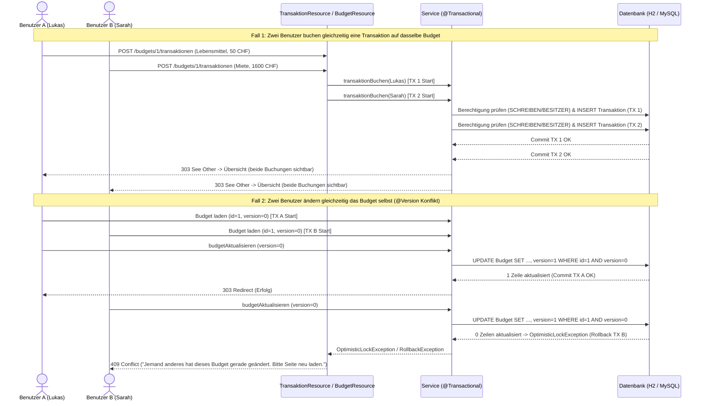

# Transaktionen und Nebenläufigkeit (`TRANSAKTIONEN.md`)

## 1. Transaktionale Service-Methoden (`@Transactional`)

In WiseBudget liegt `@Transactional` (`jakarta.transaction.Transactional`) ausschliesslich auf den datenverändernden Methoden im Service-Layer (nicht auf Resources oder Repositories). Lesezugriffe laufen ohne explizite Schreibtransaktion.

| Service | Methode | Warum `@Transactional`? |
|---|---|---|
| `BenutzerService` | `registrieren(...)` | Prüft auf eindeutige E-Mail und speichert den neuen `Benutzer` atomar in einer Datenbanktransaktion. |
| `BenutzerService` | `profilAktualisieren(...)` | Lädt den aktuellen Benutzer und schreibt alle geänderten Profilfelder gemeinsam beim Commit zurück. |
| `BudgetService` | `budgetErstellen(...)` | Erstellt das `Budget` **und** den zugehörigen `Budgetmitglied`-Eintrag (`BESITZER`). Schlägt einer der beiden Schritte fehl, wird beides zurückgerollt, damit nie ein Budget ohne Besitzer entsteht. |
| `BudgetService` | `budgetAktualisieren(...)` | Prüft Berechtigung und `@Version`, aktualisiert Name, Typ und Topf-Prozente konsistent in einer Transaktion. |
| `BudgetService` | `budgetLoeschen(...)` | Löscht zuerst abhängige Transaktionen, Einkommen, Kategorien und Mitgliedschaften und zuletzt das Budget selbst. Entweder wird alles gelöscht oder nichts. |
| `BudgetService` | `mitgliedHinzufuegen(...)` | Prüft Berechtigung und ob das Mitglied bereits existiert und speichert den neuen `Budgetmitglied`-Datensatz. |
| `BudgetService` | `berechtigungAendern(...)` | Prüft, dass mindestens ein `BESITZER` übrig bleibt, und speichert die neue Berechtigung atomar. |
| `BudgetService` | `mitgliedEntfernen(...)` | Stellt sicher, dass der letzte `BESITZER` nicht gelöscht wird, und entfernt die Mitgliedschaft in derselben Transaktion. |
| `KategorieService` | `kategorieErstellen(...)`, `kategorieUmbenennen(...)`, `kategorieLoeschen(...)` | Prüft die `SCHREIBEN`-Berechtigung (sowie beim Löschen, ob noch Transaktionen verknüpft sind) und führt die Änderung atomar durch. |
| `EinkommenService` | `einkommenErfassen(...)`, `einkommenLoeschen(...)` | Berechnet Steuer + AHV/ALV und speichert `brutto`, `steuer` und `netto` in einer einzigen Transaktion. |
| `TransaktionService` | `transaktionBuchen(...)`, `transaktionAktualisieren(...)`, `transaktionLoeschen(...)` | Prüft die `SCHREIBEN`-Berechtigung sowie die Zugehörigkeit der Kategorie zum Budget und speichert bzw. löscht die Buchung atomar. |
| `SteuerregelService` | `steuerregelErstellen(...)`, `steuerregelLoeschen(...)` | Speichert oder löscht eine Steuerregel im Admin-Bereich konsistent. |

## 2. Optimistic Locking in WiseBudget

Die Entity `Budget` besitzt ein Versionsfeld mit `@Version`:

```java
@Version
private Long version;
```

### Funktionsweise:
1. Wenn ein Benutzer (oder ein Thread) ein `Budget` liest, merkt sich Hibernate die aktuelle `version` (z. B. `version = 0`). Im Bearbeitungsformular wird diese `version` zudem als verstecktes Feld (`<input type="hidden" name="version">`) mitgegeben.
2. Beim Speichern (`UPDATE Budget SET ..., version = 1 WHERE id = ? AND version = 0`) prüft Hibernate automatisch, ob die `version` in der Datenbank noch mit dem gelesenen Stand übereinstimmt.
3. Hat in der Zwischenzeit ein anderer Benutzer dasselbe Budget geändert, steht in der Datenbank bereits `version = 1`. Das `UPDATE` trifft 0 Zeilen und Hibernate wirft eine `jakarta.persistence.OptimisticLockException` (bzw. beim Commit eine `jakarta.transaction.RollbackException` mit `OptimisticLockException` als Ursache).
4. Der zentrale [`OptimisticLockExceptionMapper`](src/main/java/ch/wisebudget/resource/OptimisticLockExceptionMapper.java) fängt sowohl direkte `OptimisticLockException`s als auch in `RollbackException` verpackte Fehler ab und gibt dem Benutzer den HTTP-Status `409 Conflict` mit der Meldung zurück:
   > «Jemand anderes hat dieses Budget gerade geändert. Bitte Seite neu laden.»

## 3. Sequenzdiagramm: Zwei Benutzer buchen / arbeiten gleichzeitig auf demselben Budget


